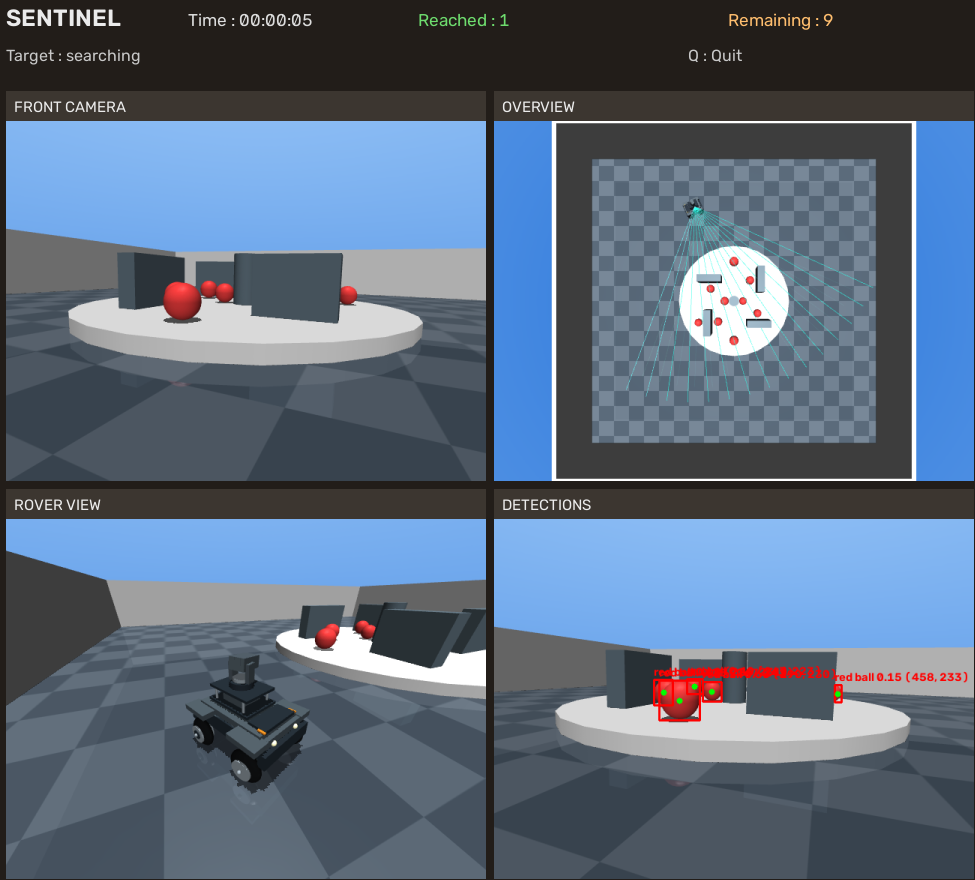
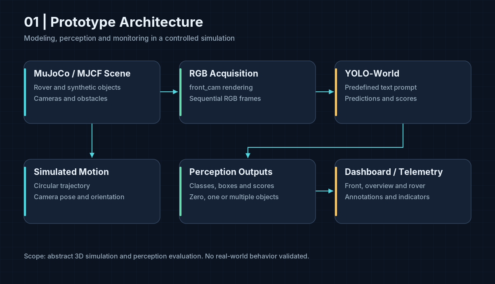
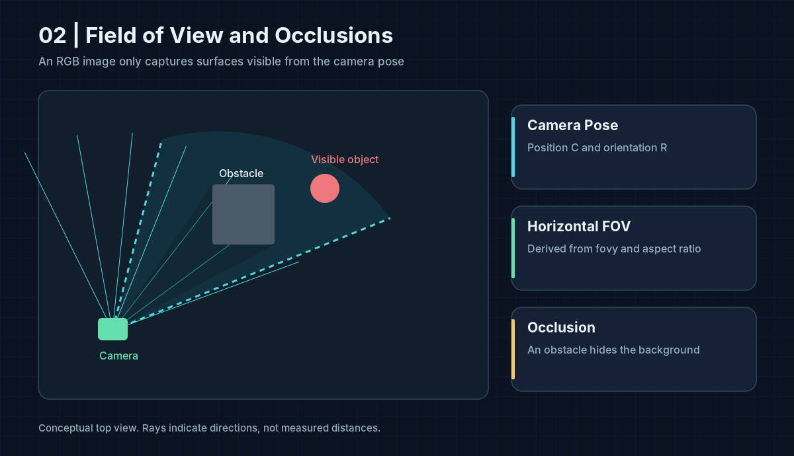
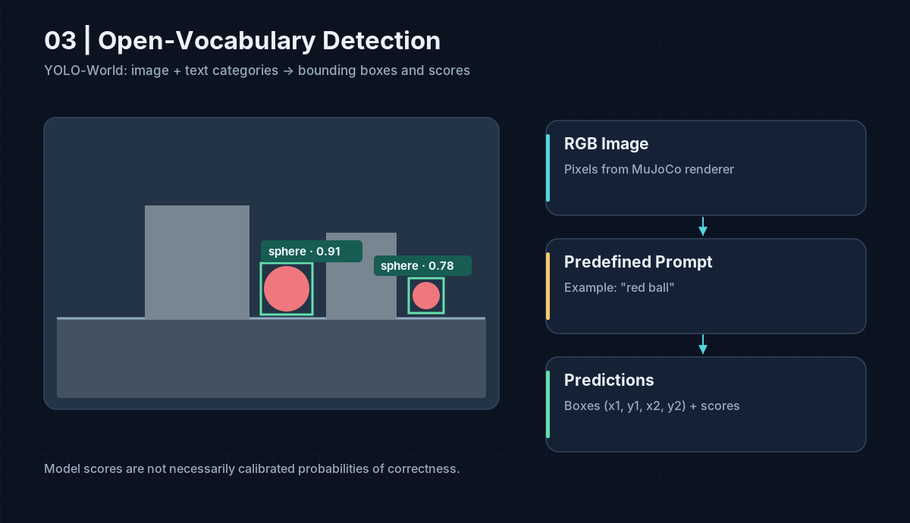
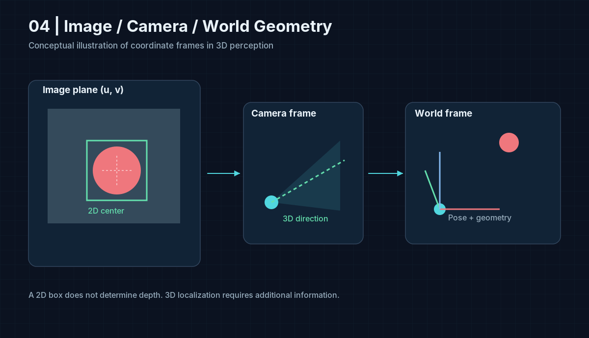

# SENTINEL - Autonomous Target Detection Robot

An autonomous robot simulation that detects and eliminates targets using computer vision and 3D physics.



## Overview

SENTINEL is a MuJoCo-based simulation of an autonomous rover equipped with:
- **4-wheel drive** for circular navigation around a target zone
- **Multiple cameras** for target detection and feedback
- **Servo-controlled turret** with cannon for target engagement
- **YOLOv8 AI** for real-time object detection

The robot automatically patrols, detects red spherical targets, tracks them with its turret, and fires when properly aligned.

## How It Works

### System Architecture



The pipeline follows these steps:

1. **Robot patrols** in a circular orbit around the target zone
2. **Camera captures** the scene continuously
3. **YOLO detector** identifies targets with confidence scores (every 0.2s)
4. **Ray casting** verifies which target is actually visible
5. **Turret tracks** the selected target smoothly
6. **Auto-fire** when turret is aligned and confident
7. **Target removed** from scene and system continues patrolling

### Vision System



Three cameras provide full situational awareness:
- **Front Camera** (70°) - Used for YOLO target detection
- **Overview Camera** - Tactical bird's-eye view
- **Rover Camera** (90°) - Onboard perspective

### Detection Pipeline



The detection works in stages:
1. Render frame from front camera
2. Run YOLO inference to find objects
3. Filter by confidence threshold (0.75)
4. Cast rays to verify which targets are really visible
5. Select primary target and track it

### 3D Coordinate Frames



The system uses multiple reference frames to calculate target positions relative to the robot's turret for accurate aiming.

## Installation

### Requirements
- Python 3.9+
- MuJoCo 3.15
- OpenCV
- PyTorch with YOLOv8
- NumPy

### Setup

```bash
cd "Projet SENTINEL"
pip install mujoco opencv-python torch ultralytics numpy
```

## Usage

### Run the simulation

```bash
# Default scene
python main.py

# Or with specific scene
python main.py --scene scenes/scene_2.xml
```
---